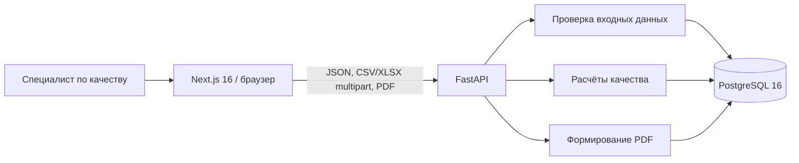

# Архитектура и функции системы годового обзора качества

## 1. Суть проекта

Система помогает специалисту по качеству собрать разрозненные сведения о лекарственном препарате за год, проверить комплектность, заметить тенденции и подготовить **черновик** годового обзора качества продукции (PQR/APQR). Демонстрационный заказчик — «Биннофарм Групп». Встроенные данные вымышлены.

Главный сценарий: **создать обзор → загрузить источники → проверить данные → изучить сигналы и историю серии → сравнить год с прошлым → подтвердить действительно нулевые события → сформулировать выводы с доказательствами → скачать PDF**.

Результат системы является рабочим материалом специалиста. Автоматические признаки не определяют причину отклонения, не присваивают регуляторный статус серии и не утверждают документ.

## 2. Состав и схема



`docker-compose.yml` поднимает три сервиса: `db`, `api`, `web`. PostgreSQL доступен только другим контейнерам, API слушает `127.0.0.1:8000`, интерфейс — `127.0.0.1:3000`. Данные PostgreSQL сохраняются в Docker volume `sashe_postgres_data`. Браузер обращается к FastAPI напрямую по `NEXT_PUBLIC_API_URL`; CORS ограничен `http://localhost:3000`.

### Почему выбран этот стек

| Компонент | Роль и причина выбора |
| --- | --- |
| Next.js 16, React 19, TypeScript | Интерактивный интерфейс с типами данных; запускается в обычном браузере на разных рабочих местах. |
| FastAPI, Pydantic | Явные контракты HTTP, проверка входных параметров, загрузка файлов и встроенная документация `/docs`. |
| SQLAlchemy, psycopg | Транзакционное сохранение обзоров, записей, подтверждений и выводов в PostgreSQL. |
| PostgreSQL 16 | Постоянное хранение и ограничения уникальности; JSON-поле позволяет принимать записи разных разделов при общей структуре. |
| openpyxl | Чтение XLSX, включая даты в формате ячейки Excel. |
| ReportLab | Независимая от браузера генерация PDF; контейнер содержит шрифт DejaVu Sans для кириллицы. |
| Docker Compose | Воспроизводимый локальный запуск всего проекта одной командой. |

### Интерфейс и айдентика

Сайт использует предоставленный логотип «Биннофарм Групп». Иконка вкладки в `icon.svg` повторяет его узнаваемые элементы: синее разомкнутое кольцо и букву «Б», чтобы знак читался в малом размере. Палитра и плотная табличная подача поддерживают рабочий характер системы качества. На широком экране разделы расположены в боковой панели; на телефоне навигация закрепляется снизу. Интерфейс разделён на три задачи: обзор показателей, исходные данные и подготовка отчёта.

### Структура репозитория

```text
SASHE/
├─ backend/
│  ├─ app/main.py          # модели БД, HTTP API, импорт, снимок обзора, PDF и демо
│  ├─ app/analysis.py      # объяснимые сигналы и сравнение годов
│  ├─ tests/               # HTTP и smoke-тесты
│  ├─ requirements.txt
│  └─ Dockerfile
├─ frontend/
│  ├─ src/app/page.tsx     # обзор, импорт, реестр, редактор отчёта
│  ├─ src/app/insights.tsx # сигналы, история серии, сравнение, нули, выводы
│  ├─ src/app/globals.css  # основная дизайн-система интерфейса
│  ├─ src/app/insights.css # стили новых аналитических блоков
│  ├─ src/app/icon.svg     # фирменная иконка вкладки
│  ├─ scripts/record-demo.mjs # сценарий видеодемонстрации
│  ├─ public/              # логотип заказчика
│  └─ Dockerfile
├─ demo/                   # видеозапись, пример PDF и учебный XLSX
├─ docs/
│  ├─ product-spec.md      # тексты, правила и критерии приёмки
│  └─ architecture.md
├─ docker-compose.yml
└─ README.md
```

## 3. Модель данных

| Таблица | Назначение и основные поля |
| --- | --- |
| `reviews` | Область обзора: `product`, `site`, `year`; свободные поля `conclusion`, `actions`. Уникальная комбинация препарата, площадки и года. |
| `quality_records` | Одна исходная запись: `review_id`, `category`, `record_date`, `batch_id`, JSON `data`. При новых импортах JSON содержит `_source_file`, `_source_sha256`, `_source_row`. |
| `import_runs` | Журнал загрузок: раздел, имя файла, SHA-256, число строк и время. Уникальный хеш на раздел и обзор блокирует повтор того же файла. |
| `section_attestations` | Активное подтверждение отсутствия событий: раздел, проверенный источник, имя специалиста и время подтверждения. |
| `evidence_findings` | Экспертный вывод по сигналу: текст, ключ сигнала и зафиксированный список ID исходных записей. |

Все дочерние сущности относятся к одному `review_id`. Снимок обзора (`snapshot`) формируется из таблиц при запросе и не сохраняется как отдельная копия. Сигналы также пересчитываются из актуальных записей; уже добавленный доказательный вывод сохраняет выбранные на момент добавления ID.

Схема создаётся через SQLAlchemy `create_all` при старте API. Это достаточный механизм для MVP, но он не меняет существующие столбцы; для промышленной версии нужны управляемые миграции.

## 4. Функциональность

### 4.1. Область обзора и демонстрационный сценарий

Обзор создаётся по препарату, площадке и году. Повторная попытка с той же комбинацией открывает существующий обзор. Кнопка «Открыть демо» создаёт вымышленные обзоры одного препарата за 2024 и 2025 годы. В 2025 году показатель растворения постепенно снижается, оставаясь внутри указанных границ; это позволяет показать ранний сигнал и сравнение с 2024 годом.

### 4.2. Импорт и проверка источников

Доступны CSV (UTF-8/Windows-1251, разделитель `,` или `;`) и XLSX размером до 5 МБ. Шаблон колонок скачивается для каждого раздела. Система проверяет обязательные поля, даты и принадлежность отчётному году, числовые значения, порядок нижней и верхней границ, повторяющиеся идентификаторы внутри файла и уже загруженных данных. Файл с ошибками не записывается частично. Успешный импорт записей и строки журнала выполняется в одной транзакции.

Разделы данных: исходное сырьё, упаковочные материалы, произведённые серии, контроль процесса, контроль качества, отклонения, OOS/OOT, изменения, рекламации, CAPA, стабильность, отзывы продукции, изменения в регистрационном досье, валидация, оборудование/помещения, технические соглашения.

### 4.3. Снимок и базовая аналитика

`GET /reviews/{id}/snapshot` возвращает количества записей, состояния разделов, последние записи, источники импорта, ряды числовых показателей, результаты вне заданных границ, сигналы, сравнение, подтверждения и доказательные выводы. Интерфейс показывает сводные показатели, реестр и графики с границами спецификации.

Для раздела различаются три состояния: **записи загружены**, **отсутствие событий подтверждено**, **не проверено**. Отсутствие файла не интерпретируется как ноль событий.

### 4.4. Объяснимые сигналы качества

Числовые результаты анализируются отдельно по разделу, параметру и единице измерения. Правила в `analysis.py`:

1. Четыре последних результата строго снижаются или растут.
2. Последний результат находится в пределах 15% ширины диапазона от нижней или верхней границы.
3. Результат вышел за границы, указанные в файле.

Для каждого сигнала возвращаются название, точное правило, значения, даты, серии и ID записей. Порог 15% — демонстрационный параметр MVP, а не нормативная граница или утверждённое правило заказчика. Сигнал означает «проверить», а не «причина установлена».

### 4.5. Хронология серии

По номеру серии API выбирает записи **только этого обзора** с точным совпадением `batch_id` и сортирует их по дате. В боковой панели видны испытания, отклонения и другие события, относящиеся к серии. Записи без номера серии не связываются автоматически; совпадение событий не объявляется причинной связью.

### 4.6. Сравнение с прошлым годом

Предыдущий обзор ищется по точно тому же препарату и площадке за год `текущий − 1`. Сопоставляются произведённые серии, отклонения, рекламации, OOS/OOT, открытые CAPA и средние значения совпадающих числовых показателей. Частоты событий рассчитываются на 100 серий. Если серий нет, частота равна «н/д», а не нулю. Сравнение описательное и не заявляет статистической значимости.

### 4.7. Подтверждение отсутствия событий

Для событийных разделов специалист может явно подтвердить ноль событий, указав источник проверки и своё имя. Подтверждение блокируется, если записи уже есть. Загрузка записей в подтверждённый раздел также блокируется до отзыва подтверждения. Активное подтверждение видно на экране и в PDF. Для несобытийных разделов (например, серия или лабораторный результат) эта функция недоступна.

### 4.8. Выводы с доказательствами и PDF

Специалист выбирает обнаруженный сигнал, редактирует формулировку и добавляет его в отчёт. Система фиксирует ID записей, на которых был основан сигнал. На экране и в PDF показываются исходные значения, серия, файл и номер строки для новых импортов. Вывод можно изменить или удалить. Отдельно сохраняются общее заключение и предлагаемые действия.

PDF содержит область обзора, комплектность, подтверждения нулевых событий, показатели и сигналы, сравнение годов, реестр записей, доказательные выводы, свободное заключение, действия и список источников. Документ всегда маркирован как **черновик**.

## 5. HTTP API

| Метод и путь | Назначение |
| --- | --- |
| `GET /health` | Проверка API и соединения с БД. |
| `GET /schemas`, `GET /templates/{category}` | Схемы импорта и CSV-шаблоны. |
| `GET /reviews`, `POST /reviews`, `GET /reviews/{id}`, `PATCH /reviews/{id}` | Обзоры и экспертный текст. |
| `POST /reviews/{id}/imports` | Проверка и атомарный импорт CSV/XLSX. |
| `GET /reviews/{id}/snapshot` | Все расчёты и данные для интерфейса. |
| `GET /reviews/{id}/batches/{batch_id}/timeline` | История серии. |
| `POST /reviews/{id}/attestations`, `DELETE /reviews/{id}/attestations/{category}` | Подтверждение или отзыв нулевых событий. |
| `POST /reviews/{id}/findings`, `PATCH /reviews/{id}/findings/{finding_id}`, `DELETE /reviews/{id}/findings/{finding_id}` | Доказательные выводы. |
| `GET /reviews/{id}/report.pdf` | Скачивание PDF-черновика. |
| `POST /demo` | Идемпотентное создание демонстрационных обзоров. |

Интерактивная спецификация OpenAPI доступна на `http://localhost:8000/docs`.

## 6. Локальное развёртывание

Из корня репозитория при запущенном Docker Desktop:

```powershell
docker compose up --build -d
```

Откройте `http://localhost:3000`. Данные сохраняются при `docker compose down`. Команда `docker compose down -v` удаляет том БД и все сохранённые обзоры. Подробный вариант разработки без Docker описан в корневом `README.md`.

## 7. Проверки и покрытие

`backend/tests/test_features.py` проверяет сигналы, историю серии, сравнение, источники доказательств, подтверждённый ноль, противоречивый импорт и PDF. `backend/tests/smoke.py` проверяет базовый импорт CSV/XLSX и ошибки. По измерению `pytest-cov` от 26.11.2026 тесты новых сценариев покрывают **90% строк Python-кода** (модуль анализа — 94%). Отдельно выполняются `npm run build`, `npm run lint` и проверка пользовательского пути в браузере. Тестовая SQLite-база изолирована; рабочая система использует PostgreSQL.

## 8. Границы MVP и развитие

Система не интегрирована с ERP/LIMS/QMS, не содержит ролей, электронной подписи, неизменяемого аудита, утверждения документа и компьютеризированной валидации. Поэтому её нельзя использовать как промышленную GxP-систему или архив утверждённых обзоров. Следующий инженерный этап: миграции схемы, права доступа, журнал изменений, сопоставление с SOP конкретной площадки, интеграции с источниками и формальная валидация правил анализа.

Нормативный ориентир проекта: [Правила GMP ЕАЭС, Решение Совета ЕЭК № 77](https://docs.eaeunion.org/documents/306/2586/). Приведённые алгоритмы и поля интерфейса являются инженерной реализацией MVP, а не дословным текстом правил.
